# Báo cáo ứng dụng định danh ZK với Semaphore

## Bỏ phiếu ẩn danh trong nhóm trên Ethereum Sepolia

**Học phần:** Blockchain Technology and Cryptocurrency · Seminar Topic 5

**Phụ trách bản thảo nghiên cứu và nội dung:** Nguyễn Hữu Anh

**Ngày đối chiếu:** 20 tháng 10 năm 2026

**Mã nguồn được khảo sát:** `ee19f1d00f7ed9777d068ef965915d9d97830ed3`

**Tình trạng:** Bản thảo để nhóm đọc duyệt và tích hợp vào report cuối cùng.

Project minh họa cách một người chứng minh mình thuộc nhóm ba thành viên mà không đưa danh tính thành viên vào bằng chứng công khai. Người đó tạo proof trên máy, gửi proof đến ứng dụng bỏ phiếu trên Sepolia và được cộng một phiếu nếu hợp lệ. Nullifier giúp phát hiện việc dùng lại cùng identity trong cùng scope. Đây là anonymous group membership; lựa chọn YES hoặc NO vẫn công khai.

Phần demo cốt lõi đã có mã nguồn và ảnh chụp kết quả. Đợt kiểm tra ngày 20/10/2026 chạy lại thành công cả năm script off-chain và xác minh được `proof.json` gốc. Kết quả Sepolia trong báo cáo dựa trên ảnh do nhóm cung cấp; chưa xác minh độc lập trạng thái hiện tại bằng RPC hoặc explorer trong đợt đối chiếu này. Chưa đủ căn cứ kết luận toàn bộ bài seminar đã hoàn tất, vì slide PDF, video dự phòng và việc tập thuyết trình chưa có trong repository được khảo sát.

| Hạng mục | Bằng chứng hiện có | Đánh giá |
|---|---|---|
| Identity và nhóm Merkle | `setup.js`, script 01 và 02, chạy lại thành công | Đã có |
| Tạo và kiểm tra proof | Script 03, `proof.json`, kiểm tra cục bộ | Đã có |
| Nullifier và người ngoài nhóm | Script 04 và 05, ảnh gốc, chạy lại thành công | Đã có |
| Bỏ phiếu trên Sepolia | Solidity và ảnh giao dịch, counter, lỗi bỏ phiếu lặp | Có bằng chứng nhóm cung cấp |
| Nội dung và nguồn nghiên cứu | Báo cáo này và `SOURCES.md` | Bản thảo đã chuẩn bị |
| Slide PDF và video dự phòng | Không thấy trong commit khảo sát | Cần nhóm bổ sung hoặc xác nhận |

Tài liệu được biên soạn với hỗ trợ AI theo phân công research và nội dung. Nguyễn Hữu Anh cần đọc, kiểm tra và duyệt trước khi sử dụng hoặc nhận hoàn thành phần nghiên cứu cá nhân. Việc viết phần lý thuyết và tổng hợp ảnh không đồng nghĩa tác giả đã xây dựng hay triển khai demo.

<!-- page -->

## 1 Yêu cầu của seminar và phạm vi nghiên cứu

Handout xác định Topic 5 là một ứng dụng ZK, chọn một zk-rollup hoặc một hệ định danh ZK, giải thích cơ chế và có demo nhỏ. Nhóm này chọn Semaphore để trình bày anonymous membership qua tình huống bỏ phiếu. Ba câu hỏi trọng tâm là chứng minh điều gì và giấu điều gì; dùng proof system nào và có trusted setup không; thời gian tạo proof và chi phí kiểm tra on-chain là bao nhiêu. [H1, S1]

Các đầu ra được handout nêu rõ gồm slide PDF, danh sách nguồn, demo trực tiếp hoặc ghi hình và contribution log. Bài trình bày dài 15 phút, thêm 5 phút hỏi đáp; mọi thành viên đều phải nói. Checklist cuối handout còn yêu cầu video dự phòng. Report này là tài liệu nội dung để nhóm xây dựng bài; handout được cung cấp không liệt kê riêng report Word là deliverable bắt buộc. [H1]

### Quy tắc nguồn và cách trích dẫn

Nhóm cần ít nhất ba nguồn sơ cấp. Handout chấp nhận paper, đặc tả, tài liệu chính thức, mã nguồn và dữ liệu on-chain tự kiểm tra; không giới hạn mọi nguồn phải là paper. Hai nguồn khởi đầu đúng với lựa chọn này là Semaphore docs và bài của Jens Groth năm 2016. Nguồn khởi đầu là nơi bắt đầu đọc, không phải danh mục đóng. [H1]

Trong bản thảo, ký hiệu S1 đến S11 dẫn đến nguồn công khai; E1 là ảnh demo gốc và H1 là handout nội bộ. Mỗi mục trong danh sách nguồn có tên tài liệu, tác giả hoặc tổ chức, URL và ngày truy cập. Với code, vị trí tra cứu là tên file và hàm, ưu tiên tag 4.14.4 hoặc commit khảo sát. Những con số thực nghiệm dẫn đến ảnh hoặc log chạy, không dẫn đến paper để tạo cảm giác chúng là benchmark của paper.

### Câu hỏi nghiên cứu

1. Làm sao chứng minh một commitment nằm trong nhóm mà không tiết lộ commitment nào được sử dụng?
2. Làm sao nhận ra cùng một identity đã hành động trong một scope mà không cần nhận dạng người đó?
3. Ranh giới giữa bảo đảm mật mã của Semaphore và quy tắc nghiệp vụ của hợp đồng bỏ phiếu nằm ở đâu?

Phạm vi hiện tại không bao gồm xác minh danh tính sinh viên thật, bỏ phiếu kín bằng mã hóa lựa chọn, chống mua phiếu, hay thiết kế hệ thống bầu cử sẵn sàng triển khai thực tế.

<!-- page -->

## 2 Kiến trúc và bài toán của ứng dụng

Tình huống demo có ba identity mang nhãn Student A, Student B và Student C. Các nhãn giúp người xem theo dõi chương trình; chúng không phải hồ sơ sinh viên đã được nhà trường xác thực. `setup.js` chọn Student B làm người tạo proof, message bằng 1 và scope là chuỗi `NEU_BLOCKCHAIN_ELECTION_2026`. [S10]

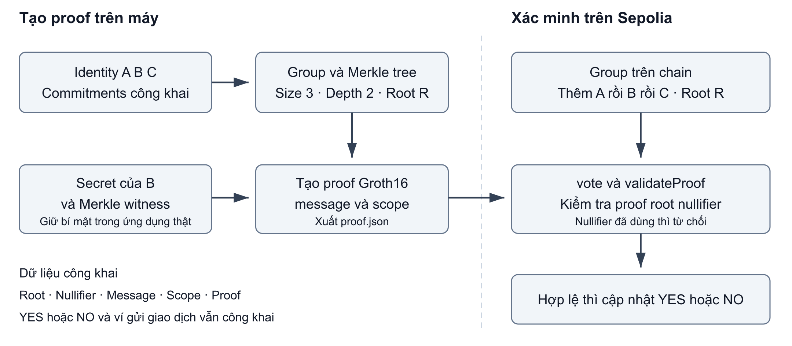

*Hình 1. Luồng dữ liệu của bản demo, được dựng từ `setup.js`, script 03 và `NEUAnonymousVoting.sol`. Sơ đồ do phần nghiên cứu tổng hợp; đây không phải ảnh chụp chương trình.*

Off-chain, chương trình tạo các identity, tính commitment, dựng nhóm, tạo membership witness và sinh proof. On-chain, ứng dụng quản lý một Semaphore group, chuyển proof đến Semaphore để kiểm tra và cập nhật bộ đếm. Ethereum xử lý giao dịch; người gửi giao dịch vẫn có địa chỉ công khai. [S10]

| Dữ liệu | Vai trò | Công khai hay bí mật |
|---|---|---|
| Private key và secret scalar | Cho phép chủ identity tạo witness | Cần giữ bí mật trong ứng dụng thật |
| Commitment | Đại diện identity trong danh sách nhóm | Công khai |
| Merkle path và vị trí leaf của prover | Witness chứng minh leaf thuộc cây | Không đưa vào proof công khai |
| Root, nullifier, message và scope | Giá trị được kiểm tra với proof | Công khai |
| Địa chỉ gửi transaction | Tài khoản trả gas và gửi giao dịch | Công khai |

Merkle path có thể được tính từ danh sách thành viên công khai. Điều ZK che giấu là path và leaf nào được prover sử dụng, chứ không bắt buộc toàn bộ cấu trúc cây phải bí mật. [S3, S4, S5]

<!-- page -->

## 3 Cơ chế identity và membership của Semaphore V4

### Identity commitment

Ba package `identity`, `group` và `proof` trong lockfile đều là 4.14.4. Báo cáo dùng cơ chế V4 tương ứng, tránh lấy công thức identity trapdoor và identity nullifier của các phiên bản cũ rồi áp vào bản demo này. Trong mã nguồn identity V4, commitment là Poseidon của hai tọa độ public key Baby Jubjub được suy ra từ secret scalar. [S3, S10]

`P = BabyPbk(s)`

`C = Poseidon(Px, Py)`

Ở đây s là secret scalar của identity, P là public key và C là commitment. Trong chương trình thật, s không được công bố. Demo dùng seed cố định có sẵn trong code để tái lập kết quả; vì vậy bí mật của ba identity demo có thể được người đọc code tái dựng. [S3, S10]

### Group và Merkle root

`new Group([A, B, C])` chèn ba commitment theo thứ tự A rồi B rồi C. Semaphore V4 dùng LeanIMT, một cây Merkle nhị phân tăng dần có độ sâu thay đổi theo số leaf; nhánh lẻ được xử lý theo cấu trúc LeanIMT. Không nên vẽ mặc định một leaf 0 thứ tư rồi khẳng định đó là đúng cây đang chạy. [S4]

Nhóm demo có size bằng 3, depth bằng 2 và root sau:

`6498286868080503464706567261660316009394353363423272750810098232448081721079`

Giá trị này khớp giữa lần chạy lại cục bộ, file `proof.json` của repository và ảnh `getGroupRoot()` do nhóm cung cấp. Thứ tự thêm leaf phải giống nhau để tái tạo cùng root. [S10, E1]

### Statement và witness

Statement có thể diễn đạt như sau: tồn tại một secret scalar s và một đường đi Merkle sao cho commitment sinh từ s thuộc cây có root R; đồng thời nullifier và message được ràng buộc đúng với scope và proof. Witness gồm s cùng thông tin membership. Verifier nhận các giá trị công khai, không nhận s hoặc chỉ số thành viên đã dùng. [S5, S6]

Một proof hợp lệ chỉ chứng minh các quan hệ đã mã hóa trong circuit. Nó không tự chứng minh người đó là sinh viên thật, không chứng minh một người không có nhiều identity và không xác nhận quy trình cho phép gia nhập nhóm là đúng.

<!-- page -->

## 4 Nullifier và ranh giới chống bỏ phiếu lặp

Trong bản 4.14.4, scope dạng chuỗi trước hết được chuyển thành số theo bytes32. Sau đó thư viện tạo giá trị Hscope bằng Keccak256 của biểu diễn uint256 32 byte rồi dịch phải 8 bit. Circuit nhận Hscope; công thức bên trong circuit là Poseidon của scope đã xử lý và secret scalar. Message cũng được xử lý bằng hàm hash tương ứng trước khi đi vào circuit. [S5, S6, S7]

`Hscope = uint256(keccak256(bytes32(scopeNumber))) >> 8`

`N = Poseidon(Hscope, s)`

Hai lần tạo proof bằng cùng identity và cùng scope tạo cùng N, kể cả proof dùng randomness khác nhau. Nếu đổi scope, identity đó có thể tạo nullifier khác. Vì vậy không nên nói prover chỉ có thể tạo một proof; prover có thể sinh nhiều proof, nhưng ứng dụng chỉ chấp nhận một lần sử dụng nullifier trong group. [S5, S6, S8]

Giá trị scope công khai trong `proof.json` của demo là:

`35402903853580900596323873445934230682237015175608477375620056997925803261952`

Nullifier của Student B trong scope đó là:

`16523579051188024369005266188935954535497426080463518653636934540149481224375`

Đây là giá trị demo công khai, không phải private key. Trong ứng dụng có secret thực sự bí mật, người xem không suy ra được thành viên chỉ từ proof. Trong repository này các seed cố định đều đã công khai; người xem có thể tính nullifier ứng viên để gắn lại nhãn Student B. Do đó bộ dữ liệu này minh họa luồng giao thức, chưa tạo quyền riêng tư thực tế cho người sở hữu seed demo.

### Vì sao hợp đồng hiện tại chưa bảo đảm một người một phiếu

`vote()` nhận scope từ người gọi và không kiểm tra scope đó có phải scope cố định của cuộc bầu cử hay không. Mọi scope được cộng vào cùng `yesVotes` và `noVotes`. Suy ra từ code: một identity có thể dùng scope khác để tạo proof khác và tiếp tục tác động vào cùng bộ đếm. Đợt kiểm tra cục bộ đã xác nhận proof đổi scope vẫn hợp lệ và nullifier thay đổi; chưa gửi giao dịch để thử hành vi này trên Sepolia. [S10]

Cách diễn đạt đúng cho kết quả hiện có là: demo chặn dùng lại nullifier trong group; với cùng identity và cùng scope, lần sử dụng thứ hai bị từ chối. Muốn dùng cho một election cần khóa scope, quản lý quyền đăng ký identity và xử lý quy tắc nghiệp vụ tại lớp ứng dụng.

<!-- page -->

## 5 Groth16 và trusted setup

Paper nền tảng là Jens Groth, *On the Size of Pairing-based Non-interactive Arguments*, EUROCRYPT 2016, trang 305–326, DOI 10.1007/978-3-662-49896-5_11; thông tin thư mục và URL nằm ở S2. Paper trình bày preprocessing zk SNARK cho quan hệ thỏa mãn circuit. Ba tính chất cần phân biệt là completeness, soundness và zero knowledge. [S2, Introduction; §2.2]

Ở mức khái niệm, Setup tạo tham số dùng chung; Prove sử dụng statement và witness để tạo proof; Verify kiểm tra statement cùng proof. Trong §3.2, proof gồm ba phần tử nhóm A, B, C và được kiểm tra bằng quan hệ pairing. Số phần tử nhóm không phải số chữ số hay số phần tử JSON. [S2, §3.2, PDF trang 16–17]

### Đối chiếu với phần mềm thực tế

Mã `generate-proof.ts` 4.14.4 gọi `groth16.fullProve`; `verify-proof.ts` gọi `groth16.verify`. Dữ liệu `points` có tám số là cách đóng gói tọa độ của proof Groth16. Số phần tử trong `points` không bao gồm toàn bộ metadata như root, message hoặc scope. Đây là bằng chứng trực tiếp về proof system mà phần off-chain đang dùng. [S6, S7]

Groth16 phù hợp với hướng triển khai này vì proof gọn và có bộ verifier Solidity tương thích trong hệ sinh thái Semaphore. Việc chọn nó trong bài là sử dụng công nghệ của thư viện hiện có; nhóm chưa tự so sánh Groth16 với PLONK hay STARK bằng thực nghiệm.

### Trusted setup cần được giải thích thế nào

Groth16 sử dụng tham số setup dành cho circuit. Cần bảo đảm phần bí mật của quá trình setup không bị giữ lại để tạo proof giả. Tài liệu Semaphore mô tả việc tạo tham số bằng trusted setup ceremony. Nhóm demo tải các artifact có sẵn; các script không tổ chức ceremony riêng. [S1, phần Trusted Setup Ceremony; S2, §3.2]

Một chi tiết phiên bản cần lưu lại là package proof 4.14.4 mặc định yêu cầu artifact version 4.13.0. Báo cáo không suy diễn package version phải trùng artifact version. Đợt kiểm tra này chưa kiểm toán transcript ceremony hoặc đối chiếu hash zkey với lịch sử ceremony. Không nên dùng việc demo chạy thành công để khẳng định nhóm đã kiểm chứng toàn bộ quá trình setup. [S6]

<!-- page -->

## 6 Triển khai off chain và dữ liệu chuyển sang Remix

| File | Vai trò thực tế |
|---|---|
| `setup.js` | Tạo ba identity cố định, dựng group, chọn B, message và scope |
| `01_identity.js` | In ba commitment |
| `02_group.js` | In số thành viên và root |
| `03_generate_proof.js` | Đo thời gian gọi generateProof, kiểm tra proof, ghi JSON |
| `04_nullifier_test.js` | Sinh hai proof với cùng identity và scope rồi so nullifier |
| `05_nonmember_test.js` | Thử tạo proof cho identity không có trong group |
| `proof.json` | Dữ liệu công khai để kiểm tra proof và truyền sang hợp đồng |
| `NEUAnonymousVoting.sol` | Lớp ứng dụng bỏ phiếu sử dụng Semaphore |

### Các trường trong proof json

| Trường | Giá trị hoặc ý nghĩa trong demo |
|---|---|
| `merkleTreeDepth` | 2; dùng chọn verifier và artifact tương ứng |
| `merkleTreeRoot` | Root của nhóm A, B, C |
| `nullifier` | Giá trị phát hiện sử dụng lại identity trong scope |
| `message` | 1 là YES; 0 là NO theo quy ước ứng dụng |
| `scope` | Ngữ cảnh hành động, được xuất ra dạng số |
| `points` | Mảng tám số đóng gói proof Groth16 |

`verifyProof(proof)` cục bộ kiểm tra proof với root và các public signals được cung cấp. Nó không tự biết root đó có thuộc một group cụ thể trên Sepolia hay chưa và không lưu danh sách nullifier đã dùng. Việc proof trả về true trên máy chưa đồng nghĩa transaction sẽ được chấp nhận. [S7, S8]

Đối với người ngoài nhóm, script 05 hiện thất bại khi thư viện không tìm thấy leaf và không tạo được Merkle path. Đây là phép thử witness construction của chương trình. Nó không phải một cuộc thử tấn công bằng proof giả gửi lên hợp đồng và không phải chứng minh thực nghiệm đầy đủ về soundness.

Lưu ý tái chạy: `npm start` hiện trỏ đến `demo.js` nhưng file này không có trong commit khảo sát. Dùng trực tiếp năm script có tên ở trên. Hợp đồng import package contracts qua Remix; package contracts chưa được khóa trong lockfile Node của project. Báo cáo không tự nhận đã biên dịch lại đúng bytecode bản deploy.

<!-- page -->

## 7 Triển khai on chain và cách cập nhật phiếu

Constructor nhận địa chỉ Semaphore, tạo group mới và đặt chính hợp đồng ứng dụng làm group admin. `addMember(commitment)` chuyển yêu cầu thêm leaf đến Semaphore. Các hàm `getGroupSize()`, `getGroupDepth()` và `getGroupRoot()` đọc trạng thái nhóm. [S10]

Khi người gọi gửi sáu tham số từ JSON, `vote()` dựng lại struct `SemaphoreProof` rồi gọi `semaphore.validateProof(groupId, proof)`. Nếu bước đó thành công, message bằng 1 làm tăng yesVotes; message bằng 0 làm tăng noVotes. Không có bước so sánh `msg.sender` với nhãn Student B. Người gửi giao dịch và identity tạo proof là hai vai trò khác nhau. [S10]

Theo mã nguồn Semaphore 4.14.4, validateProof kiểm tra nullifier đã dùng, gọi verifyProof, lưu nullifier và phát event. VerifyProof kiểm tra group, root và proof; ngoài root hiện tại, một số root cũ còn có thể được chấp nhận trong thời hạn lưu root. Vì vậy “root phải bằng root hiện tại trong mọi trường hợp” là diễn đạt quá mạnh. Demo chỉ sử dụng trường hợp đơn giản local root bằng current on-chain root. [S8]

### Các định danh của lượt demo gốc

**Mạng:** Ethereum Sepolia, chain ID 11155111 theo tài liệu nhóm.

**Semaphore được ghi trong demo:** `0x8A1fd199516489B0Fb7153EB5f075cDAC83c693D`

**Hợp đồng ứng dụng:** `0x25fBB307A9bb19757eB5647517e28328D09502a4`

**Group ID nhìn thấy trong ảnh:** 741.

**Block của lượt vote thành công trong ảnh:** 11942285.

**Transaction hash được chép từ ảnh gốc:**

`0x73b0ceaf931ab40900286e04269fba29e09abdc9934cba0d9d74da3111261433`

Tra cứu công khai tại [giao dịch Sepolia của lượt demo](https://sepolia.etherscan.io/tx/0x73b0ceaf931ab40900286e04269fba29e09abdc9934cba0d9d74da3111261433). Trong phiên đối chiếu, explorer và hai RPC công khai không trả được dữ liệu sử dụng được; hash, gas và kết quả lịch sử trong báo cáo do đó vẫn là bằng chứng ảnh nhóm cung cấp. [E1]

Trang Deployed contracts hiện được truy cập liệt kê Semaphore Sepolia là `0xC10E5102A2Cc077BE3B9740Fc0Ad7e27Ff8E0245`, khác địa chỉ trong demo gốc. Đây là chênh lệch cần đối chiếu lịch sử deployment; chưa đủ để kết luận địa chỉ gốc là sai. Không tự thay địa chỉ khi tái hiện, vì group và trạng thái cũ thuộc deployment cụ thể. [S9]

<!-- page -->

## 8 Snapshot tạo identity group và proof

Các hình từ đây đến hết mục 11 được trích nguyên ảnh từ `Blockchain-Demo-Step-by-Step.docx`, giữ nguyên nội dung. Ngày chụp không được suy ra từ ngày viết báo cáo. Các ảnh là kết quả nhóm đã ghi lại; log tái chạy ngày 20/10/2026 được trình bày riêng ở mục 12. [E1]

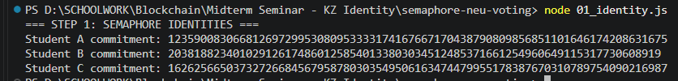

*Hình 2. Script 01 in ba commitment A, B, C. Chỉ commitment được đưa vào group; không dùng ảnh này để nhận đó là ba sinh viên đã qua xác thực.*

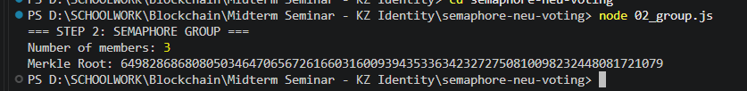

*Hình 3. Script 02 cho thấy group có ba thành viên và root khớp file JSON.*

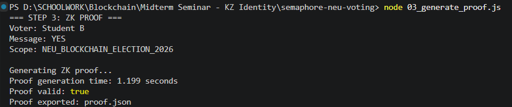

*Hình 4. Lần chạy gốc cho kết quả proof valid bằng true và thời gian tạo proof 1.199 giây. Đây là một quan sát riêng lẻ, chưa phải thời gian trung bình.*

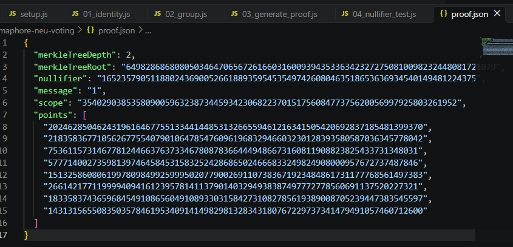

*Hình 5. File proof.json chứa root, nullifier, message, scope và proof points. Đây là dữ liệu công khai được dùng trong bước on-chain.*

<!-- page -->

## 9 Snapshot nullifier và người ngoài nhóm

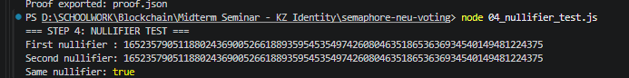

*Hình 6. Hai lần sinh proof bằng cùng identity và scope cho cùng nullifier. Kết quả này không yêu cầu hai proof points phải giống nhau.*

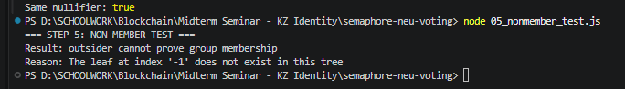

*Hình 7. Identity outsider không xuất hiện trong cây; thư viện báo leaf tại chỉ số âm một không tồn tại. Đây là từ chối ở bước tạo membership witness.*

Giá trị nullifier lặp trong ảnh là dấu hiệu để ứng dụng phát hiện một identity đã được sử dụng trong cùng scope. Việc “hai nullifier giống nhau” chỉ là phần đầu của cơ chế; để chống lặp cần thêm bộ nhớ trạng thái tại nơi validate. Trong demo, bộ nhớ này thuộc Semaphore contract, không thuộc hàm verifyProof cục bộ. [S7, S8]

Việc script 05 báo lỗi đúng mong đợi cần được đọc cùng message của chương trình. Script bắt mọi exception rồi thoát với mã 0; chỉ nhìn exit code 0 không đủ kết luận phép thử đã thành công. Log phải thể hiện đúng nguyên nhân leaf không có trong cây, thay vì lỗi mạng hoặc không tải được artifact. Lần chạy lại đã quan sát đúng lỗi thiếu leaf. [S10]

### Nội dung thuyết minh cho hai hình

“Một identity có thể sinh nhiều proof, nhưng trong cùng scope các proof đó có cùng nullifier. Hợp đồng có thể từ chối nullifier đã dùng mà không cần nhận dạng người tạo proof. Với outsider, commitment không nằm trong nhóm nên chương trình hiện tại không dựng được witness thành viên. Hai phép thử minh họa hai lớp khác nhau: điều kiện membership và chống sử dụng lại.”

<!-- page -->

## 10 Snapshot trạng thái nhóm trên Sepolia

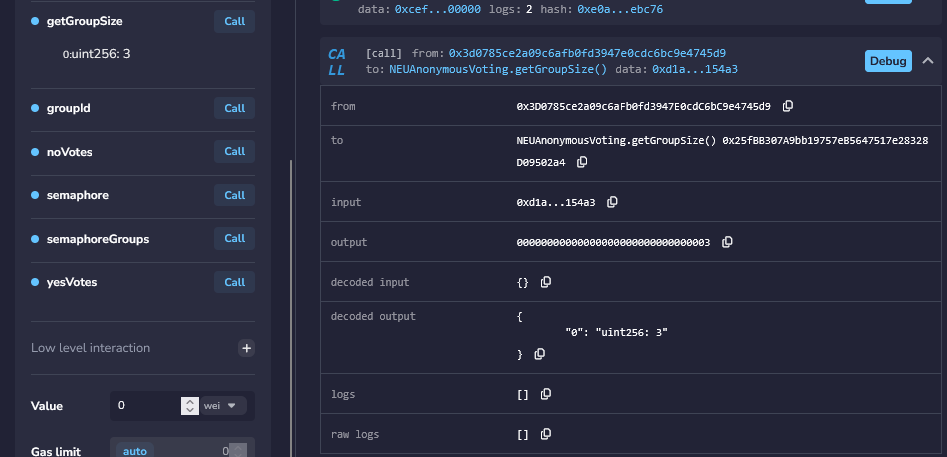

*Hình 8. Sau khi thêm A, B, C, getGroupSize trả về 3.*

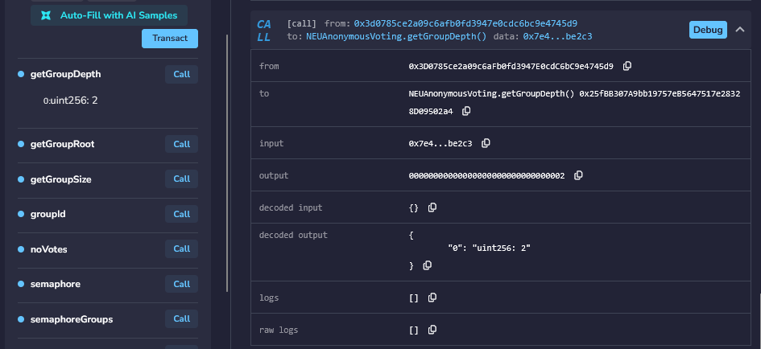

*Hình 9. getGroupDepth trả về 2, khớp merkleTreeDepth trong JSON.*

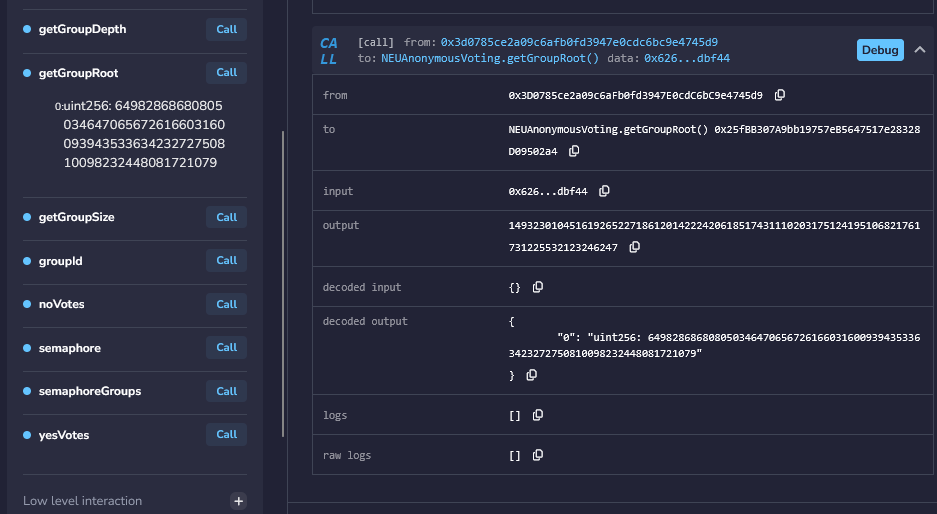

*Hình 10. getGroupRoot hiển thị cùng root với ảnh chạy cục bộ. Đây là bước kiểm tra sự nhất quán giữa nhóm off-chain và group đã dùng cho demo on-chain.*

<!-- page -->

## 11 Snapshot vote thành công và từ chối lặp

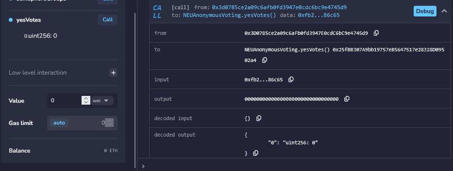

*Hình 11. yesVotes trước lượt bỏ phiếu được ghi lại bằng 0.*

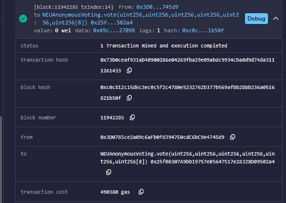

*Hình 12. Remix hiển thị giao dịch đã được mined, block 11942285 và transaction cost bằng 490380 gas. Chỉ số này thuộc toàn bộ lời gọi vote.*

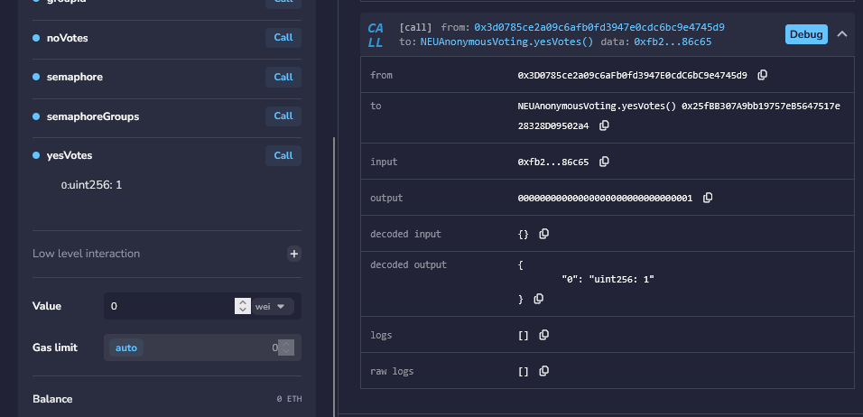

*Hình 13. yesVotes sau lượt vote thành công bằng 1. Khi ghép Hình 11 và Hình 13, nhóm quan sát chuyển trạng thái từ 0 sang 1.*

<!-- page -->

## 11 Snapshot từ chối lặp tiếp theo

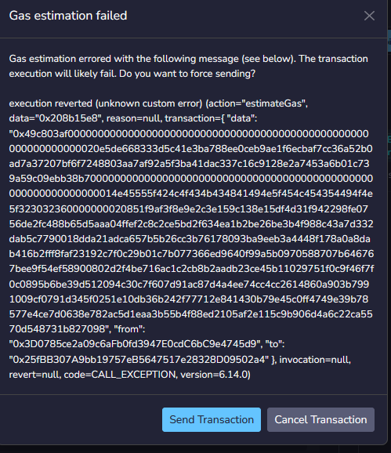

*Hình 14. Lần thử gửi lại proof gặp lỗi ở bước estimateGas. Dữ liệu lỗi bắt đầu bằng 0x208b15e8; phép tính selector cục bộ khớp lỗi Semaphore__YouAreUsingTheSameNullifierTwice().*

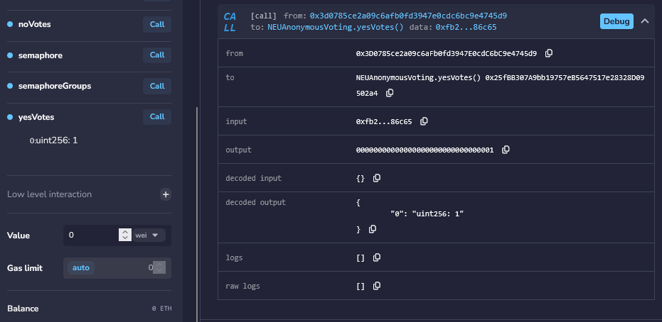

*Hình 15. yesVotes vẫn bằng 1 sau lần thử lặp. Không diễn đạt đây là một giao dịch thất bại đã được ghi vào block: ảnh hiện có cho thấy lỗi khi mô phỏng ước lượng gas trước khi gửi.*

<!-- page -->

## 12 Kết quả kiểm tra và cách đọc số liệu

Đợt kiểm tra ngày 20/10/2026 dùng Node.js 24.19.0 trên macOS arm64, cài dependency theo các phiên bản chuyển từ package-lock, không chạy install scripts. Ba package Semaphore đều được đối chiếu là 4.14.4. File proof.json gốc được khôi phục nguyên byte sau lần chạy script 03. Log và kết quả bổ sung nằm trong `docs/evidence/`. Không có transaction mới nào được gửi lên Sepolia.

| Kiểm tra | Kết quả trong lần đối chiếu |
|---|---|
| Script 01 | Tạo lại đúng ba commitment |
| Script 02 | Size 3 và root khớp bản gốc |
| Script 03 | Proof valid true, thời gian 1.581 giây |
| Script 04 | Same nullifier true |
| Script 05 | Không tạo được witness của outsider vì thiếu leaf |
| Xác minh proof.json gốc | True |
| Đổi scope khi tạo proof | Proof vẫn valid, nullifier khác |
| Selector lỗi dùng lại nullifier | 0x208b15e8, khớp ảnh lỗi |
| Trạng thái Sepolia hiện tại | Chưa xác minh độc lập trong phiên này |

### Thời gian tạo proof

Ảnh demo gốc ghi 1.199 giây; lần chạy lại ghi 1.581 giây. Hai số được đo trên các lần chạy và môi trường khác nhau, không gộp thành một trung bình. Timer của script bao quanh generateProof nên có thể bao gồm tải hoặc đọc artifact nếu thư viện thực hiện việc đó trong lời gọi; không bao gồm verifyProof nằm sau timer. Khẳng định khoảng 0.4–0.9 giây trong README chưa được hai bằng chứng trên hỗ trợ. [S10, E1]

Để có benchmark chính thức, ghi CPU, RAM, hệ điều hành, Node, package version và cách cache artifact; chạy một lượt khởi động rồi nhiều lượt đo, báo số mẫu và median, đồng thời tách thời gian prove, verify cục bộ và độ trễ xác nhận block. Đây là quy trình đề xuất, chưa phải benchmark nhóm đã thực hiện.

### Chi phí giao dịch

Con số có bằng chứng là 490380 gas cho toàn bộ vote transaction của ảnh gốc. Nó bao gồm chi phí giao dịch, kiểm tra proof và trạng thái liên quan, ghi nullifier, phát event và cập nhật counter. Chưa đo riêng verifier nên không gán toàn bộ gas này cho Groth16. Gas là đơn vị tính công việc; phí ETH còn phụ thuộc effective gas price. Không dùng Sepolia test ETH làm bằng chứng chi phí tiền thật của hệ thống.

<!-- page -->

## 13 Giới hạn và việc cần hoàn thiện

### Quyền gia nhập nhóm chưa được kiểm soát

Mặc dù ứng dụng là group admin tại Semaphore, wrapper addMember hiện public và không có kiểm tra quyền. Người gọi có thể nhờ wrapper thêm commitment vào nhóm. Vì vậy claim “chỉ sinh viên đã được duyệt mới được bỏ phiếu” chưa đúng với code hiện tại. Cần thêm kiểm soát đăng ký và chính sách một người có bao nhiêu identity. [S10]

### Scope và message cần được ứng dụng xác thực

Scope tùy ý là giới hạn trực tiếp đối với quy tắc một identity một phiếu trong cùng election. Đồng thời, hợp đồng không require message thuộc tập 0 và 1 trước validateProof. Một proof hợp lệ có message khác vẫn có thể được validate và tiêu thụ nullifier nhưng không tăng bộ đếm nào. Cần khóa scope và kiểm tra message trước khi tiêu thụ proof. Đây là phân tích code, chưa phải bản sửa đã deploy. [S10]

### Quyền riêng tư phụ thuộc dữ liệu và cách gửi giao dịch

Seed demo công khai cho phép tái dựng identity và liên kết nullifier với nhãn. Trong triển khai thật cần secret được tạo an toàn và không công bố. Ngay cả khi secret an toàn, message YES/NO và địa chỉ trả gas vẫn công khai; dữ liệu mạng, thời điểm gửi và cách nạp tiền có thể tạo liên kết bên ngoài proof. Bộ demo ba identity cũng chỉ tạo tập ứng viên rất nhỏ.

### Không đồng nhất kiểm tra cục bộ với toàn bộ hệ thống

Proof valid cục bộ không kiểm tra trạng thái nullifier trên chain. Ảnh lỗi estimateGas không phải receipt của một transaction revert. Outsider thất bại khi tạo path không thay thế kiểm thử verifier với proof sai. Báo cáo giữ các mức bằng chứng này tách biệt.

### Các bước để chốt bài seminar

| Việc cần chốt | Đầu ra cần kiểm tra |
|---|---|
| Nguyễn Hữu Anh đọc duyệt nội dung và nguồn | Sửa claim hoặc citation nếu phát hiện sai; duyệt bản thảo |
| Đối chiếu Sepolia bằng explorer hoặc RPC hoạt động | Receipt, gasUsed, địa chỉ Semaphore thực, trạng thái nhóm |
| Quyết định phạm vi demo | Giữ bản giáo dục và nêu giới hạn, hoặc sửa rồi tái kiểm tra |
| Làm slide và trang Sources | Slide PDF, đủ tiêu đề, tác giả, URL, ngày truy cập |
| Ghi video và tập trình bày | Video dự phòng, 15 phút, mọi thành viên đều nói |
| Hoàn thiện contribution log của cả nhóm | Thành viên tự xác nhận phần làm và liên kết bằng chứng |

<!-- page -->

## 14 Khung nội dung thuyết trình và hỏi đáp

| Phần | Thời lượng | Nội dung và bằng chứng |
|---|---|---|
| Bài toán | 2 phút | Tư cách thành viên và quyền riêng tư; phạm vi ẩn người tạo phiếu |
| Cơ chế | 6 phút | Sơ đồ; commitment; Merkle witness; scope; nullifier; Groth16 và setup |
| Demo | 4 phút | Tạo proof; so root; vote thành công; lỗi sử dụng lại; hình 4 và 10–15 |
| Đánh giá | 2 phút | 1.199 giây ở ảnh gốc; 490380 gas; scope và quyền đăng ký |
| Sources | 1 phút | Semaphore docs, Groth16, mã nguồn có phiên bản và bằng chứng demo |

Thành viên phụ trách nghiên cứu và nội dung có thể trình bày câu hỏi “proof thực sự chứng minh gì”, phân biệt công khai với bí mật và giải thích giới hạn của hai con số hiệu năng. Người xây dựng demo trình bày thao tác và kết quả theo phân công thực tế. Chưa gán tên người nói cho các phần còn lại vì ảnh chat không xác định đầy đủ danh sách nhóm.

### Các câu hỏi nhóm cần trả lời được

**Đây có phải bỏ phiếu kín không?** Chưa. Message YES/NO vẫn công khai. Giao thức hướng tới ẩn liên kết với identity thành viên; seed công khai trong demo còn làm mất bảo mật thực tế của các identity mẫu.

**Người gửi transaction có phải Student B không?** Transaction chỉ cho thấy ví gửi; proof mới gắn với membership. Hai vai trò không bắt buộc trùng nhau.

**Tại sao tạo lại proof không giúp bỏ phiếu lại trong cùng scope?** Proof points có thể khác, nhưng nullifier vẫn giống; validateProof từ chối nullifier đã dùng trong group.

**Đổi scope thì sao?** Nullifier khác. Code hiện chưa khóa scope nên đây là giới hạn cần trình bày, không phải một bảo đảm một người một phiếu cho cả election.

**Vì sao dùng Groth16?** Phần mềm Semaphore đã chọn cơ chế này; mã thư viện gọi fullProve và verify của Groth16. Paper giải thích cấu trúc proof gọn; nhóm chưa benchmark so sánh proof systems.

**Đã hoàn thành project chưa?** Có luồng demo cốt lõi và bằng chứng ảnh. Bài seminar chỉ hoàn tất sau khi nhóm duyệt nội dung, chốt nguồn, bổ sung slide, video dự phòng, tập nói và log đóng góp của mọi người.

<!-- page -->

## 15 Tài liệu tham khảo

Các nguồn S1–S11 dưới đây là tài liệu chính thức, paper, đặc tả hoặc mã nguồn. Nhiều file cùng một repository là các vị trí kiểm chứng, không phải nhiều nghiên cứu độc lập. Bộ nguồn gồm paper Groth16, tài liệu chính thức Semaphore, đặc tả V4 và mã nguồn có phiên bản; khi kiểm tra tiêu chí ba nguồn sơ cấp cần giữ cách phân loại này. Toàn bộ nguồn web được truy cập ngày **2026-10-20**.

**S1.** Semaphore Protocol và Privacy and Scaling Explorations. *What Is Semaphore?* Tài liệu chính thức V4. [Semaphore documentation](https://docs.semaphore.pse.dev/). Vị trí dùng: Overview và Trusted Setup Ceremony. Đây là nguồn khởi đầu trong handout. Truy cập 2026-10-20.

**S2.** Jens Groth. *On the Size of Pairing-based Non-interactive Arguments.* EUROCRYPT 2016, LNCS 9666, trang 305–326. DOI [10.1007/978-3-662-49896-5_11](https://doi.org/10.1007/978-3-662-49896-5_11). [IACR ePrint 2016/260](https://eprint.iacr.org/2016/260). Bản tác giả tại [UCL Discovery](https://discovery.ucl.ac.uk/1501201/1/Groth_SNARK9.pdf). Vị trí: Abstract; Introduction; §2.2; §3.2. PDF bản UCL trang 16–17 không phải số trang proceedings. Đây là nguồn khởi đầu trong handout; IACR và UCL là cùng một công trình, không đếm hai paper. Truy cập 2026-10-20.

**S3.** Semaphore Protocol. *Identity implementation*, tag v4.14.4. [packages/identity/src/index.ts](https://github.com/semaphore-protocol/semaphore/blob/v4.14.4/packages/identity/src/index.ts). Vị trí: Identity constructor và commitment getter. Truy cập 2026-10-20.

**S4.** Semaphore Protocol. *Group implementation*, tag v4.14.4. [packages/group/src/index.ts](https://github.com/semaphore-protocol/semaphore/blob/v4.14.4/packages/group/src/index.ts). Vị trí: Group constructor và LeanIMT. Truy cập 2026-10-20.

**S5.** Semaphore Protocol. *Semaphore circuit*, tag v4.14.4. [semaphore.circom](https://github.com/semaphore-protocol/semaphore/blob/v4.14.4/packages/circuits/src/semaphore.circom). Vị trí: template Semaphore; BabyPbk; BinaryMerkleRoot; nullifier; dummySquare. Truy cập 2026-10-20.

**S6.** Semaphore Protocol. *Proof generation implementation*, tag v4.14.4. [generate-proof.ts](https://github.com/semaphore-protocol/semaphore/blob/v4.14.4/packages/proof/src/generate-proof.ts). Đối chiếu thêm [hash.ts](https://github.com/semaphore-protocol/semaphore/blob/v4.14.4/packages/proof/src/hash.ts) và [to-bigint.ts](https://github.com/semaphore-protocol/semaphore/blob/v4.14.4/packages/proof/src/to-bigint.ts). Vị trí: artifact version, groth16.fullProve, xử lý scope và message. Truy cập 2026-10-20.

**S7.** Semaphore Protocol. *Proof verification implementation*, tag v4.14.4. [verify-proof.ts](https://github.com/semaphore-protocol/semaphore/blob/v4.14.4/packages/proof/src/verify-proof.ts). Vị trí: verificationKey và groth16.verify. Truy cập 2026-10-20.

**S8.** Semaphore Protocol. *Semaphore Solidity contract*, tag v4.14.4. [Semaphore.sol](https://github.com/semaphore-protocol/semaphore/blob/v4.14.4/packages/contracts/contracts/Semaphore.sol). Vị trí: validateProof, verifyProof và _hash. Đây là nguồn đối chiếu cơ chế; chưa xác nhận bytecode của địa chỉ deployment gốc trùng tag này. Truy cập 2026-10-20.

<!-- page -->

## 15 Tài liệu tham khảo tiếp theo

**S9.** Semaphore Protocol. *Deployed contracts.* [Danh sách deployment chính thức](https://docs.semaphore.pse.dev/deployed-contracts). Vị trí: Sepolia. Được dùng để ghi nhận địa chỉ hiện trên docs khác tài liệu demo, không để thay địa chỉ deployment gốc. Truy cập 2026-10-20.

**S10.** Nhóm project, tài khoản công bố tnamgia76-debug. *KZ Identity Demonstration.* [Repository tại commit khảo sát](https://github.com/tnamgia76-debug/KZ-Identity-Demonstration/tree/ee19f1d00f7ed9777d068ef965915d9d97830ed3). Vị trí: setup.js; script 01–05; proof.json; NEUAnonymousVoting.sol; package.json; package-lock.json; README.md. Đây là nguồn sơ cấp về chính bản demo, không phải paper nghiên cứu độc lập. Truy cập 2026-10-20.

**S11.** Vivian Plasencia, biên tập; Andy, Cedoor và Oskar Thoren, đóng góp. *Semaphore V4 Specification.* Ethereum access layer specifications, trạng thái draft tại thời điểm đọc. [Đặc tả V4](https://github.com/ethereum/access-layer-specs/blob/main/specs/3-semaphore-v4/README.md). Vị trí: Identity; Group; Nullifier; Circuit Design; Security Considerations. Dùng hỗ trợ thuật ngữ; khi cần chi tiết thực thi ưu tiên code 4.14.4. Truy cập 2026-10-20.

**E1.** Nhóm project. *Blockchain Demo Step by Step.* File `Blockchain-Demo-Step-by-Step.docx` do Nguyễn Hữu Anh cung cấp, nhận để đối chiếu ngày 2026-10-20. Không có URL công khai của tài liệu gốc trong bộ file nhận. Ảnh được trích nguyên byte; tên ảnh và SHA256 có trong `SNAPSHOTS.md`. Các hình cho thấy kết quả lịch sử, không được ghi là truy vấn chain mới.

**H1.** Giảng viên học phần. *Seminar Handout — Topics, Starter Sources & Process.* File `seminar-topics-26.md` do người học cung cấp. Tài liệu ghi links checked 09/2026; đối chiếu ngày 2026-10-20. Vị trí: mục 1; mục 3–5; Topic 5; checklist mục 7. Chưa có URL công khai do người học cung cấp.

### Mẫu nguồn rút gọn cho slide cuối

Jens Groth. *On the Size of Pairing-based Non-interactive Arguments.* IACR ePrint 2016/260, EUROCRYPT 2016. https://eprint.iacr.org/2016/260 (accessed 2026-10-20).

Semaphore Protocol và PSE. *What Is Semaphore?* V4. https://docs.semaphore.pse.dev/ (accessed 2026-10-20).

Semaphore Protocol. *Semaphore source code*, tag v4.14.4, circuit và proof implementation. https://github.com/semaphore-protocol/semaphore/tree/v4.14.4 (accessed 2026-10-20).

Nhóm nên giữ citation ngắn tại slide có claim, chẳng hạn “Groth16 [Groth 2016, §3.2]”, rồi đặt thông tin đầy đủ ở Sources. Với số liệu demo, ghi “Ảnh demo nhóm, 1.199 giây, một lần chạy” hoặc “vote transaction, 490380 gas, block 11942285”; không viết các con số đó là kết quả của Groth 2016.
